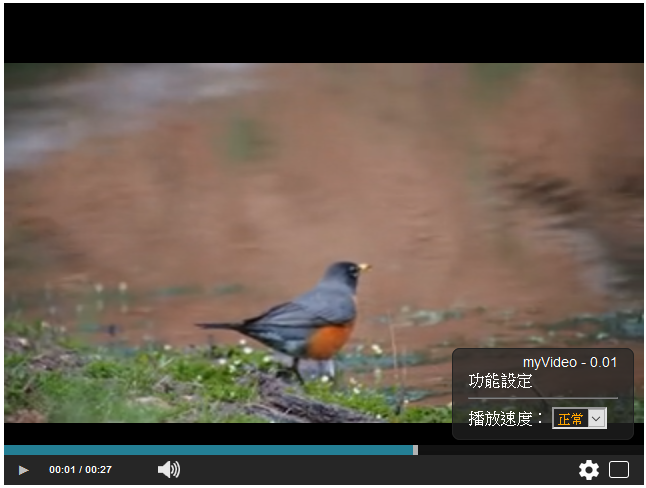

myVideo
=====

我的 Html5 Video 播放機，基於jQuery Plugin方式撰寫。

## V0.05（2026-11-03）

沿用原本的 jQuery 與 `<video><source>` 用法，無須 jQuery UI。設定面板新增「循環播放」與「預載下一段」，兩者預設勾選。

```javascript
var player = $("#demo1").myVideo({
  width: "640px",
  height: "480px",
  merge: true,
  loop: true,
  preloadNext: true,
  loadTimeout: 15000
});

// 關閉彈窗或重建播放器前，可明確釋放播放器資源。
player.destroy();
// 也可使用 $("#demo1").myVideo("destroy");
```

| 選項 | 預設值 | 行為 |
| --- | --- | --- |
| `loop` | `true` | 最後一段播完接回第一段。關閉時停在結尾，再按播放會從第一段重新開始。 |
| `preloadNext` | `true` | 使用一個隱藏的原生影片元素預載下一段；可由設定面板即時開關。只有一段影片時不建立預載元素。 |
| `loadTimeout` | `15000` | 單次來源載入、預載或片長探測的等待上限（毫秒）；目前影片失敗或逾時會顯示提示，可按播放重試。 |

預載保留原本主 `<video>` 元素，利用瀏覽器的媒體快取縮短接段等待；不保證無縫或零間隔。效果取決於瀏覽器的預載策略、可用頻寬與伺服器的 `Cache-Control`／Range 支援，並會提早使用下一段影片的流量。沒有預先提供 `req_duration` 時，仍需額外讀取各段 metadata 以建立完整時間軸（最多同時兩個探測）。

`req_duration` 應是有效的正數秒數，提供後用作時間軸長度。可用 `ffprobe -v error -show_entries format=duration -of default=noprint_wrappers=1:nokey=1 "movie.mp4"` 查詢。不提供或提供無效值時會自動讀取影片片長；所有片長就緒前不開放合併時間軸跳轉。

`getSource()` 的既有用法保留；事件標記會在片長就緒後依所有前段的累積長度計算。點擊標記會直接跳到該事件時間，避免長影片的進度條像素誤差。傳入的 `req_events` 仍是 Base64 編碼的 JSON 陣列。

V0.05 修正：

- 靜音解除後正確還原音量，不再反覆縮小。
- 進度條在區域外放開滑鼠後結束拖曳，並支援 Pointer Events 觸控拖曳。
- 時間軸 100% 正確定位最後一段結尾，快速跨段跳轉以最後一次目標為準。
- 處理播放 Promise、影片讀取錯誤與逾時；暫停跳轉不再先呼叫播放。
- 事件標記納入沒有標記的前段，並支援非同步讀取片長。
- 移除永久時間輪詢；`destroy()` 清理事件、計時器與輔助影片。有 `MutationObserver` 的瀏覽器會在播放器從文件移除後自動清理；僅隱藏的播放器仍應明確呼叫 `destroy()`。

jQuery 相容性：已在 Chromium 使用官方 jQuery 3.7.1 與 4.0.0 完整版，各通過 23 項回歸測試，未載入 jQuery Migrate；先前亦驗證 jQuery 1.8.3 的基本播放、跳轉與清理。事件標記改用原生 `Array.isArray()`，相容 jQuery 4.0 移除 `$.isArray()` 的變更。控制列淡入淡出依賴效果模組，請使用完整版，非 slim 版。

預載量測：使用獨立瀏覽器環境、允許快取、每次影片請求延遲 350 ms，提供 1.4 秒預載時間，開關各量測三次；接段至第一個影格的中位數為關閉約 806 ms、開啟約 127 ms。這是受控條件的結果，並非所有網路環境的速度保證；Safari 與真機行動瀏覽器尚未驗證。

固定版本：`myVideo-0.05.js`。`myVideo-lastest.js` 同步為相同內容；歷史檔案 `myVideo-0.1.js`～`myVideo-0.4.js` 保留。

---

<center>
  <h2>我的 Html5 Video 播放機</h2>
  <br>
  <h3>myVideo 哥的播放機</h3>
  <br>
  <h4>自製 HTML5 播放機 UI，可以調整播放速度、合併多個不同來源的 MP4 檔案合併時間軸接序播放，基於jQuery Plugin方式撰寫。</h4>
  <br>
  <br>
  <div align="center" style="margin-left:auto;margin-right:auto;">
  
  <br>
  哥的播放機    
  </div>
  <br>
  <h2 class="title">程式資訊：</h2>
  <div style="text-align:left;margin-left:50px;">
    Author：<br>
    &nbsp;&nbsp;&nbsp;&nbsp;&nbsp;&nbsp;&nbsp;&nbsp;
    Feather Mountain(羽山) <a target="_blank" href="https://3wa.tw">https://3wa.tw</a>
    <br>
    版本：<br>
    &nbsp;&nbsp;&nbsp;&nbsp;&nbsp;&nbsp;&nbsp;&nbsp;V 0.05<br>
    最後更新時間：<br>
    &nbsp;&nbsp;&nbsp;&nbsp;&nbsp;&nbsp;&nbsp;&nbsp;2026-11-03<br>
    License：<br>
    &nbsp;&nbsp;&nbsp;&nbsp;&nbsp;&nbsp;&nbsp;&nbsp;MIT License<br>
    官網：<br>
    &nbsp;&nbsp;&nbsp;&nbsp;&nbsp;&nbsp;&nbsp;&nbsp;
    <a target="_blank" href="https://3wa.tw/demo/htm/myVideo/">https://3wa.tw/demo/htm/myVideo/</a>
    <br>
    &nbsp;&nbsp;&nbsp;&nbsp;&nbsp;&nbsp;&nbsp;&nbsp;
    <a target="_blank" href="https://github.com/shadowjohn/myVideo">https://github.com/shadowjohn/myVideo</a>
    <br>
    程式名稱：<br>
    &nbsp;&nbsp;&nbsp;&nbsp;&nbsp;&nbsp;&nbsp;&nbsp;
    mybox 哥的播放機    <br>    
    Donwload：<br>
    &nbsp;&nbsp;&nbsp;&nbsp;&nbsp;&nbsp;&nbsp;&nbsp;
    <a target="_blank" href="https://3wa.tw/inc/javascript/jquery/myVideo/myVideo-lastest.js">myVideo-lastest.js</a>
    &nbsp;&nbsp;
    <a target="_blank" href="https://3wa.tw/inc/javascript/jquery/myVideo/myVideo.css">myVideo.css</a>        
    <br>    
    Key Word：<br>
    &nbsp;&nbsp;&nbsp;&nbsp;&nbsp;&nbsp;&nbsp;&nbsp;
    Html5 Video Player Merge 
    <br>
  </div>
  <h2 class="title">功能參數說明：</h2>
  <table border="1" cellpadding="5" cellspacing="0" class="thetable">
    <tr>
      <th>參數或方法</th>
      <th>名稱</th>
      <th>測試</th>
    </tr>
    <tr>
      <th>傳統用法</th>
      <td>        
<pre title='source_code' alt='source_code' id='source_code' class='comments'>
&lt;head&gt;
  &lt;!--在 head 加入 --&gt;
  &lt;script src="https://3wa.tw/inc/javascript/jquery/myVideo/myVideo-lastest.js"&gt;&lt;/script&gt;
  &lt;link href="https://3wa.tw/inc/javascript/jquery/myVideo/myVideo.css" rel="stylesheet" type="text/css" /&gt;
  &lt;script&gt;
    $(document).ready(function(){
      $("#demo1").myVideo();
    });
  &lt;/script&gt; 
&lt;/head&gt;
&lt;body&gt;
  &lt;video id="demo1" 
      poster="https://3wa.tw/demo/htm/myVideo/demo1/20200911_1599757205758_1599753607320.png"&gt;
    &lt;source 
      src="https://3wa.tw/demo/htm/myVideo/demo1/20200911_1599757205758_1599753607320.mp4" 
      type="video/mp4"&gt;
  &lt;/video&gt;
&lt;/body&gt;          
</pre>
      </td>
      <td>
        <a target="_blank" href="demo1/index.html">執行</a>
      </td>
    </tr>
    <tr>
      <th>基本參數</th>
      <td>
<pre title='source_code' alt='source_code' id='source_code' class='comments'>
{
  'width': '320px', /*調整寬*/
  'height':'240px', /*調整高*/
  'merge': false    /*不合併*/
}        
</pre>
      </td>
      <td>
        <a target="_blank" href="demo2/index.html">執行</a>
      </td>
    </tr>
    <tr>
      <th>參數說明</th>
      <td>
<pre title='source_code' alt='source_code' id='source_code' class='comments'>
{
  'width': '320px', /*調整寬*/
  'height':'240px', /*調整高*/
  'merge': true     /* 合併 */
}

//合併影片時，建議可以在 source 加一個參數，如 req_duration="471.388997"，如此可以加速載入速度
//duration 建議事先用 ffprobe 查詢，語法：
ffprobe 20200911_1599793208459_1599789604914.mp4 -show_streams -select_streams v:0 -of json ooxx.mp4

&lt;video id="demo1" 
        poster="https://3wa.tw/demo/htm/myVideo/demo1/20200911_1599757205758_1599753607320.png"&gt;    
  &lt;source req_duration="16.684" 
        src="https://images.all-free-download.com/footage_preview/mp4/deer_animal_food_eating_bushes_474.mp4"
        type="video/mp4"&gt;          
  &lt;source req_duration="10.544" 
        src="https://images.all-free-download.com/footage_preview/mp4/bird_small_animal_feathers_river_679.mp4" 
        type="video/mp4"&gt;
&lt;/video&gt;       
</pre>
      </td>
      <td>
        <a target="_blank" href="demo3/index.html">執行</a>
      </td>
    </tr>                     
  </table>
  <h2 class="title">參考資料</h2>
  全螢幕寫法的 UI 不會被摭住：https://codepen.io/benjaminhoegh/pen/VQRGwx #benjaminhoegh
  <br>
  <h2 class="title">ChangeLog</h2>
  <div style="text-align:left;">
    <pre style="margin-left:20px;">
* Tue Nov 03 2026 Feather Mountain &lt;https://3wa.tw&gt; 0.05
- 新增預設啟用的循環播放與下一段預載
- 修正音量、時間軸跳轉、事件標記、播放錯誤與資源清理，詳見上方 V0.05 說明

* Tus Oct 17 2023 Feather Mountain &lt;https://3wa.tw&gt; 0.04
- 加入拖拉 Bar 的功能
	
* Mon Jul 17 2023 Feather Mountain &lt;https://3wa.tw&gt; 0.03
- 加入 getSource 可以取影片清單
- 加入操作事件
	
* Thu May 12 2022 Feather Mountain &lt;https://3wa.tw&gt; 0.02
- 播放速度可以支援到 16x 但網路不夠快可能會卡頓
	
* Fri Sep 11 2020 Feather Mountain &lt;https://3wa.tw&gt; 0.01
- First initial
    </pre>
  </div>
</center>
